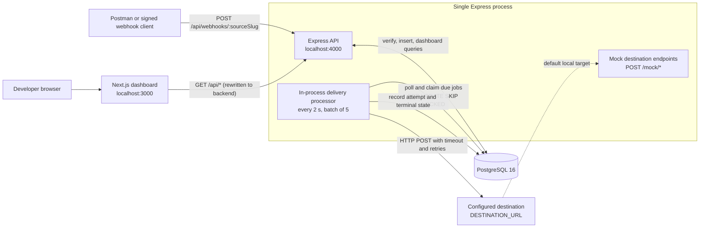
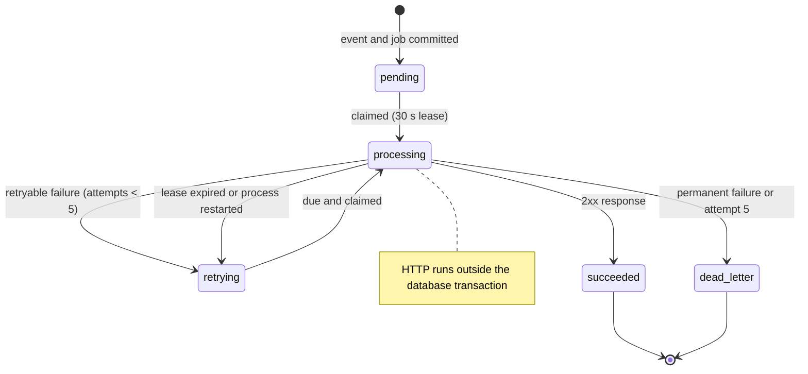

# Mini Payment Webhook Relay


## Demo Video

Watch the Mini Payment Webhook Relay Demo:

https://github.com/user-attachments/assets/febc6927-6f3c-41cd-8639-02f28221b20d

Mini Payment Webhook Relay is a learning-focused full-stack project that accepts
signed payment webhook events, verifies their HMAC signatures, stores them
durably, and delivers them to a single configured endpoint. Temporary failures
are retried with exponential backoff; permanent failures and exhausted retries
are moved to a dead-letter queue. A read-only Next.js dashboard makes the state
of every event, delivery job and attempt visible.

The project demonstrates a small, self-contained implementation of the concerns
behind reliable webhook delivery: signature verification, idempotent ingestion,
transactional persistence, a PostgreSQL-backed delivery queue, concurrency-safe
job claiming, retry scheduling and operational visibility.

> **Scope note:** PostgreSQL runs in Docker; the Node.js application runs on the
> host. Prisma Migrate owns the schema, and Prisma Client handles normal data
> access. Raw SQL is limited to the health-check `SELECT 1` and the parameterized
> `SELECT ... FOR UPDATE SKIP LOCKED` job claim. There is no transactional
> outbox, no external queue and no separate worker. One Express process serves
> the API and runs the delivery processor.

## Key Features

- HMAC-SHA256 verification over the exact raw request body, using a
  constant-time comparison.
- Duplicate-event prevention through a unique
  `(sourceId, externalEventId)` constraint and idempotent retry handling.
- Transactional creation of an inbound event and its delivery job.
- PostgreSQL-backed persistent delivery queue.
- Scheduled delivery processor running inside the existing Express process.
- Concurrency-safe job claiming with `SELECT ... FOR UPDATE SKIP LOCKED` and a
  30-second lease.
- Automatic retries with exponential backoff, 50–100% jitter and `Retry-After`
  support.
- Complete delivery-attempt history with status codes, response times and
  outcomes.
- Dead-letter handling for permanent failures and exhausted retries.
- Read-only Next.js dashboard for events, deliveries and failures.
- Unit and integration tests against a separate, isolated test database.

## Architecture



### Request and delivery flow

1. A client sends a signed JSON payload to
   `POST /api/webhooks/:sourceSlug`. The webhook router reads the raw body
   before the global JSON parser so the exact signed bytes remain available.
2. The backend resolves the active source, verifies the HMAC-SHA256 signature,
   parses the JSON and validates the required `id` and `type` fields.
3. A new event and its delivery job are committed in one Prisma transaction.
   The event starts as `queued`; the job starts as `pending` with
   `maxAttempts = 5` and `nextAttemptAt` set to now.
4. The API acknowledges the request. A duplicate event returns the existing
   event and job instead of creating new rows.
5. Every two seconds, the in-process processor recovers interrupted work,
   claims due `pending` and `retrying` jobs, and marks them `processing` with a
   30-second lease.
6. The processor sends the stored event payload to the configured destination.
   No database transaction is held open during the HTTP request.
7. The attempt and its result are recorded. Success marks the job `succeeded`
   and the event `delivered`. A retryable failure schedules another attempt; a
   permanent failure or the fifth failed attempt moves the job and event to
   `dead_letter`.
8. The dashboard reads the resulting state through the read-only APIs. It does
   not mutate events, jobs or destination configuration.

## Technology Stack

| Layer | Technology | Role |
| --- | --- | --- |
| Frontend | Next.js 16, React, JavaScript, plain CSS | Read-only monitoring dashboard using the App Router |
| Backend | Node.js 20+, Express 5, JavaScript | Webhook ingestion, dashboard APIs and in-process delivery processor |
| Database | PostgreSQL 16 (`postgres:16-alpine` in Docker) | Durable events, delivery jobs and attempt history |
| ORM and migrations | Prisma 6, Prisma Client, Prisma Migrate | Data access, transactions and schema ownership |
| Local infrastructure | Docker Compose | Local PostgreSQL container only; the application is not containerized |
| Testing | Node.js built-in test runner (`node --test`) | Unit and integration tests |

## Project Structure

```text
.
├── backend/
│   ├── config/          # Environment loading and validation
│   ├── controllers/     # HTTP request/response handling
│   ├── db/              # Shared Prisma client
│   ├── middleware/      # 404 and error handling
│   ├── prisma/
│   │   ├── migrations/  # Applied migration history
│   │   └── schema.prisma
│   ├── routes/          # Webhook, health, config, dashboard and mock routers
│   ├── services/        # Ingestion, delivery, retry policy, processor and dashboard queries
│   ├── utils/           # HMAC, URL validation, query parsing and API responses
│   ├── app.js           # Express app and middleware order
│   └── server.js        # Startup, processor lifecycle and graceful shutdown
├── database/            # Database documentation (Prisma owns the schema)
├── frontend/
│   ├── app/             # Next.js App Router entry point
│   ├── components/      # Overview, event, delivery, dead-letter and drawer views
│   ├── lib/             # API client, formatting and display-name mapping
│   └── next.config.js   # Proxies browser /api/* calls to the backend
├── scripts/
│   ├── seed-demo.js     # Additive demo data
│   ├── clear-demo.js    # Remove demo data
│   └── send-webhook.js  # Generate and send a signed webhook
├── tests/
│   ├── unit.test.js
│   ├── integration.test.js
│   └── helpers/testDatabase.js
├── docker-compose.yml   # Local PostgreSQL only
├── .env.example         # Environment template
└── package.json         # Root command aliases
```

## Prerequisites

- **Node.js 20+** and **npm**.
- **Docker Desktop** with Docker Compose support.
- Free local ports **3000** (dashboard), **4000** (API) and **5432**
  (PostgreSQL).

Docker is required only for the local PostgreSQL database. The Express API and
Next.js dashboard run directly on the host, which keeps the Node.js processes
easy to debug and restart while the database retains its data in a Docker
volume.

## Getting Started

Run all commands from the repository root unless a step says otherwise.

### 1. Start PostgreSQL

```bash
npm run db:start
```

This starts the `postgres:16-alpine` container defined in
`docker-compose.yml` on port `5432`, with data stored in the
`payment_relay_pgdata` volume.

Useful database commands:

| Command | Purpose |
| --- | --- |
| `npm run db:start` | Start PostgreSQL in Docker |
| `npm run db:stop` | Stop PostgreSQL and keep its data |
| `npm run db:logs` | Follow PostgreSQL logs |
| `npm run db:reset` | Stop PostgreSQL and delete its data volume |

### 2. Create the backend environment file

```bash
npm run setup:env
```

This copies `.env.example` to `backend/.env` only when the file does not already
exist. Open `backend/.env` and set `WEBHOOK_SECRET` to a local development value
of at least 16 characters. The default destination configuration already points
at the mock success endpoint.

### 3. Install dependencies

```bash
npm --prefix backend install
npm --prefix frontend install
```

The root `package.json` contains command aliases rather than application
dependencies.

### 4. Generate Prisma Client and apply migrations

```bash
npm run prisma:generate
npm run prisma:migrate
```

`prisma:generate` creates the Prisma Client used by the backend. The migration
step is required on a fresh database and applies the migrations in
`backend/prisma/migrations/`. To apply existing migrations non-interactively
later, use `npm --prefix backend run prisma:deploy`.

### 5. Start the backend

```bash
npm run backend:dev
```

`backend:dev` uses `nodemon` for automatic restarts. Use `npm run backend:start`
to run the API without file watching. On startup the backend:

- Connects to PostgreSQL and fails fast if it is unreachable.
- Creates or refreshes the single source and destination from environment
  configuration.
- Starts the HTTP server on `PORT` (default `4000`).
- Starts the in-process delivery processor.

### 6. Start the dashboard

In a second terminal:

```bash
npm run frontend:dev
```

Open <http://localhost:3000>. The browser calls relative `/api/*` URLs, and
`frontend/next.config.js` rewrites them to the backend, so no CORS configuration
is needed.

### 7. Verify the API and database connection

```bash
curl http://localhost:4000/api/health
```

Expected response:

```json
{
  "success": true,
  "data": {
    "status": "ok",
    "database": "connected",
    "uptimeSeconds": 1,
    "timestamp": "2026-11-09T00:00:00.000Z"
  }
}
```

The health endpoint performs a real database query. It returns `503` if
PostgreSQL cannot be reached.

### Optional: demo data

The demo scripts populate the dashboard with deterministic records and a sender
that signs a real webhook request.

```bash
# Start the backend first so startup recovery has already run.
npm run backend:dev

# In another terminal, add the demo rows.
npm run demo:seed

# Remove demo events and their cascaded jobs/attempts.
npm run demo:clear

# Send a signed event through the running relay.
npm run demo:send -- evt_demo_seed_live_001 payment.success 2500
```

`demo:seed` is additive and idempotent for demo data: it inserts only missing
events whose `externalEventId` starts with `evt_demo_seed_`, and it does not
delete or update existing demo events, delivery jobs or attempts. Re-running it
creates no duplicates.

| Records | Count | Statuses on a fresh seed |
| --- | --- | --- |
| Events | 20 | 8 `delivered`, 8 `queued`, 4 `dead_letter` |
| Delivery jobs | 20 | 8 `succeeded`, 4 `pending`, 3 `retrying`, 1 `processing`, 4 `dead_letter` |
| Delivery attempts | 27 | 8 `succeeded`, 17 `retryable_failure`, 2 `permanent_failure` |

The dataset also includes two retry-then-succeed histories and four dead-letter
cases: permanent `404`, exhausted `500`, exhausted timeout and permanent `422`.

The `pending` and `retrying` examples have a future `nextAttemptAt`; the
`processing` example holds a 10-minute demo lease. The processor will
claim or recover them normally once those times pass. Seed after the backend
starts: startup recovery treats every `processing` row as interrupted work and
moves it to `retrying`.

### Root command reference

| Command | Purpose |
| --- | --- |
| `npm run setup:env` | Create `backend/.env` from `.env.example` if missing |
| `npm run prisma:generate` | Generate the Prisma Client |
| `npm run prisma:migrate` | Create or apply a development migration |
| `npm run backend:dev` | Start the API with file watching |
| `npm run backend:start` | Start the API with `node` |
| `npm run frontend:dev` | Start the Next.js dashboard |
| `npm run frontend:build` | Build the dashboard for production |
| `npm run frontend:start` | Serve the production dashboard build |
| `npm run demo:seed` | Add missing demo records |
| `npm run demo:clear` | Remove demo records |
| `npm run demo:send` | Send a signed demo webhook |
| `npm test` | Run the backend test suites |
| `npm --prefix backend run prisma:studio` | Browse data in Prisma Studio |
| `npm --prefix backend run prisma:deploy` | Apply existing migrations non-interactively |

## Environment Configuration

The backend loads `backend/.env` with `dotenv`. The repository root contains the
documented `.env.example` template, and `npm run setup:env` copies it into place.
The backend validates configuration at startup and fails fast on missing or
invalid values.

| Variable | Required / default | Purpose |
| --- | --- | --- |
| `NODE_ENV` | `development` | Runtime mode; logged at startup. |
| `PORT` | `4000` | API port, validated as a TCP port. Also used in the default mock destination URL. |
| `DATABASE_URL` | **Required** | PostgreSQL connection string. |
| `WEBHOOK_SOURCE_NAME` | `Postman Sandbox` | Display name of the single source. |
| `WEBHOOK_SOURCE_SLUG` | `postman-sandbox` | Stable source identifier used in the webhook URL. Normalized to lowercase; letters, numbers and single hyphens only. |
| `WEBHOOK_SIGNATURE_HEADER` | `x-webhook-signature` | Header carrying the HMAC signature. Lowercased and validated as an HTTP header name. |
| `WEBHOOK_SECRET` | **Required** | HMAC-SHA256 secret, minimum 16 characters. |
| `DESTINATION_NAME` | `Local Mock Destination` | Display name of the single destination. |
| `DESTINATION_URL` | `http://localhost:<PORT>/mock/success` | Single delivery endpoint. Must use HTTP or HTTPS, must not contain embedded credentials, and must not point at a blocked metadata host. |
| `DESTINATION_TIMEOUT_MS` | `10000` | Delivery timeout in milliseconds, from `1000` to `30000`. |

Additional runtime variables used by tooling:

| Variable | Used by | Default | Purpose |
| --- | --- | --- | --- |
| `BACKEND_URL` | `frontend/next.config.js` | `http://localhost:4000` | Backend origin for the dashboard's `/api/*` rewrite. |
| `RELAY_URL` | `scripts/send-webhook.js` | `http://localhost:4000` | Backend origin used by `npm run demo:send`. |

The HMAC secret stays in the environment. The `sources` table stores only
`secretEnvVar = "WEBHOOK_SECRET"`; the secret is never written to PostgreSQL,
returned by `/api/config`, or included in delivery requests. The source and
destination rows are created or updated on every startup, and extra rows are
deactivated so the application always uses one active source and one active
destination.

## Webhook Integration and Testing

### Endpoint and payload

```text
POST /api/webhooks/:sourceSlug
```

Example payload:

```json
{
  "id": "evt_001",
  "type": "payment.success",
  "data": {
    "paymentId": "pay_123",
    "amount": 2500,
    "currency": "USD",
    "status": "succeeded"
  }
}
```

- `id` is required, must be a string, and is limited to 255 characters.
- `type` is required, must be a string, and is limited to 100 characters.
- The body must be a JSON object. The complete object is stored in
  `events.payload` as JSONB.
- The request body limit is 1 MB.
- The content type must be `application/json` or `application/*+json`.

### HMAC-SHA256 signing

The signature is an HMAC-SHA256 digest over the **exact raw request body
bytes**. Send it in the configured header as `sha256=<64 hex characters>`. A
bare 64-character hex digest is also accepted. Changing whitespace or
reformatting the JSON after signing invalidates the signature.

The checked-in `.env.example` uses
`whsec_test_2f7c9a1e5b8d4f6a9c0e3b7d1f5a8c2e` as a public local-development
placeholder. It is not a real credential. Use it only for local testing, or
replace it in `backend/.env` and use the same value in the commands below.

Generate a signature and send a request with bash:

```bash
BODY='{"id":"evt_001","type":"payment.success","data":{"amount":2500,"currency":"USD"}}'
SIG=$(printf '%s' "$BODY" | openssl dgst -sha256 -hmac "whsec_test_2f7c9a1e5b8d4f6a9c0e3b7d1f5a8c2e" -hex | sed 's/^.* //')

curl -i -X POST http://localhost:4000/api/webhooks/postman-sandbox \
  -H "Content-Type: application/json" \
  -H "x-webhook-signature: sha256=$SIG" \
  --data-binary "$BODY"
```

The same request can be sent from the included helper, which signs the exact
body it sends:

```bash
npm run demo:send -- evt_demo_seed_live_001 payment.success 2500
```

The sender loads `backend/.env` and reads `WEBHOOK_SECRET`,
`WEBHOOK_SOURCE_SLUG` and the optional `RELAY_URL`. `RELAY_URL` defaults to
`http://localhost:4000`. Reuse the same event ID to see the duplicate response.

### Postman example

Create a `POST` request to
`http://localhost:4000/api/webhooks/postman-sandbox`, set the body type to
**raw JSON**, and add this pre-request script:

```js
const secret = "whsec_test_2f7c9a1e5b8d4f6a9c0e3b7d1f5a8c2e"; // local placeholder

const signature = CryptoJS.HmacSHA256(pm.request.body.raw, secret)
  .toString(CryptoJS.enc.Hex);

pm.request.headers.upsert({
  key: "x-webhook-signature",
  value: `sha256=${signature}`,
});
```

Postman must send the raw body unchanged; the script signs
`pm.request.body.raw` exactly as it will be transmitted.

### Responses and duplicate behavior

| Status | Meaning |
| --- | --- |
| `202` | New event accepted and stored with a `pending` delivery job. |
| `200` | Duplicate event; the existing event and job are returned with `duplicate: true`. |
| `400` | Empty body, invalid JSON, non-object JSON, or missing/invalid `id` or `type`. |
| `401` | Missing or invalid signature. |
| `404` | Unknown or inactive source slug. |
| `413` | Request body exceeds 1 MB. |
| `415` | Unsupported content type or body encoding. |
| `503` | No active delivery destination is configured. |

A new event returns:

```json
{
  "success": true,
  "data": {
    "eventId": "6f3d5dcf-763f-4e1b-8afc-5539d8bf897e",
    "externalEventId": "evt_001",
    "eventType": "payment.success",
    "status": "queued",
    "jobId": "f7ac08a5-790f-4456-92ed-9b0563287fb7",
    "deliveryStatus": "pending",
    "duplicate": false,
    "receivedAt": "2026-11-09T08:36:08.094Z"
  }
}
```

Duplicate prevention is enforced by the unique
`events (sourceId, externalEventId)` constraint, so it also holds under
concurrent requests. If two requests race, the unique constraint decides the
winner and the loser returns the already committed event and job. Reusing the
same event ID never creates a second delivery job.

## Mock Destination Endpoints

The backend exposes four local stand-ins at `/mock/*`, so the single
`DESTINATION_URL` can point back at the relay during development. They are
development helpers: they do not verify signatures and are not part of the
public ingestion API.

| Endpoint | Behavior | Demonstrates |
| --- | --- | --- |
| `POST /mock/success` | Always returns `200`. | Normal successful delivery. |
| `POST /mock/failure` | Always returns `500`. | Retryable failure, retry exhaustion and dead-lettering. |
| `POST /mock/timeout` | Holds the response for 35 seconds. | Timeout handling; the destination timeout is at most 30 seconds. |
| `POST /mock/intermittent` | Returns `503` on the first attempt per delivery job and `200` on later attempts. | Retry-then-recover behavior. |

Configure the destination in `backend/.env` and restart the backend so the
startup configuration is refreshed:

```dotenv
DESTINATION_URL=http://localhost:4000/mock/success
```

Only one destination URL is active at a time. Each delivery sends JSON with these
correlation headers:

| Header | Value |
| --- | --- |
| `x-webhook-event-id` | External event ID from the payload. |
| `x-webhook-event-type` | Event type from the payload. |
| `x-webhook-delivery-job-id` | Delivery job UUID. |
| `x-webhook-delivery-attempt` | One-based attempt number. |

Mock responses echo the mode and correlation identifiers. The intermittent
endpoint tracks attempts in memory by delivery job, so each distinct job fails
exactly once and succeeds on its first retry. Restarting the backend resets that
in-memory tracking.

## Delivery Processing and Retry Strategy

### Processor loop and job claiming

The processor runs inside the existing Express process. It starts when the
server starts and polls with `setInterval()` every **2 seconds**, processing up to
**5 jobs** per tick. An in-process boolean prevents overlapping ticks.

Jobs are claimed in a short transaction using parameterized raw SQL. The core
selection is:

```sql
SELECT id
FROM delivery_jobs
WHERE status IN ('pending', 'retrying')
  AND "nextAttemptAt" <= NOW()
ORDER BY "nextAttemptAt" ASC
LIMIT $1
FOR UPDATE SKIP LOCKED
```

The actual statement wraps this selection in a CTE and updates the claimed rows
to `processing` in the same transaction.

The claim marks each selected job `processing`, sets `lockedAt`, and sets a
**30-second** `lockExpiresAt`. The transaction commits before any HTTP request
starts, so a slow destination never holds a database lock. `SKIP LOCKED` prevents
two claimers from selecting the same row.

### Delivery hardening

- Sends a JSON `POST` with an `AbortSignal` timeout from `DESTINATION_TIMEOUT_MS`.
- Treats redirects as failures instead of following them (`redirect: "manual"`).
- Drains response bodies so connections are released.
- Records timeouts and network errors with their cause, such as
  `ECONNREFUSED`.
- Sends correlation metadata in headers without any secret or signature.
- Validates the destination URL again at delivery time. An inactive destination
  is a permanent failure.

### Success and failure persistence

A successful delivery creates the attempt row, marks the job `succeeded` and
marks the event `delivered` in one Prisma transaction.

A failed delivery creates the attempt row and updates the job in one transaction:

- A retryable failure with attempts remaining sets the job to `retrying` and
  schedules `nextAttemptAt`.
- A permanent failure, or a retryable failure on the fifth attempt, sets the job
  and event to `dead_letter`.
- `delivery_attempts` rows are retained for monitoring and dead-letter views.

### Retry rules

| Result | Outcome | Action |
| --- | --- | --- |
| Any `2xx` | `succeeded` | Job `succeeded`; event `delivered`. |
| `408`, `425`, `429`, or any `5xx` | `retryable_failure` | Retry with backoff. |
| Other `4xx` and `3xx` | `permanent_failure` | Move directly to `dead_letter`. |
| Timeout, DNS failure, connection reset or refusal | `retryable_failure` | Retry with backoff. |
| Invalid or inactive destination | `permanent_failure` | Move directly to `dead_letter`. |

### Exponential backoff and jitter

Backoff starts from a **5-second** base, doubles per attempt, uses equal jitter,
and is capped at **5 minutes**:

```text
raw   = min(5000 ms * 2^(attempt - 1), 300000 ms)
delay = raw / 2 + random(0, raw / 2)
```

`attempt` is the failed attempt number. A `Retry-After` header from the
destination is parsed as seconds or an HTTP date and is honored when it requests
a longer wait than the calculated backoff. The final delay is capped at five
minutes. After the fifth failed attempt, the job is dead-lettered.

### Interrupted-job recovery

- On startup, any jobs left in `processing` by a previous run are reset to
  `retrying` with their locks cleared and `nextAttemptAt` set to now. This is
  safe because exactly one processor runs.
- On every tick, jobs whose `lockExpiresAt` has passed are recovered the same
  way.
- Every job is processed in isolation; one failure does not stop the rest of the
  batch.

### Delivery lifecycle



## Database Design

The source of truth is `backend/prisma/schema.prisma`. Applied migrations live
in `backend/prisma/migrations/`, and Prisma Migrate owns the schema.

| Table | Key columns | Purpose |
| --- | --- | --- |
| `sources` | `id`, `name` (unique), `slug` (unique), `signatureHeader`, `secretEnvVar`, `isActive` | Incoming webhook source configuration. |
| `events` | `id`, `sourceId`, `externalEventId`, `eventType`, `payload` (JSONB), `signatureVerified`, `status`, `receivedAt` | Verified inbound events with the original payload. |
| `destinations` | `id`, `name`, `url`, `timeoutMs`, `isActive` | The single configured delivery endpoint. |
| `delivery_jobs` | `id`, `eventId` (unique), `destinationId`, `status`, `attemptCount`, `maxAttempts`, `nextAttemptAt`, `lockedAt`, `lockExpiresAt`, `lastStatusCode`, `lastResponseTimeMs`, `lastError` | Persistent delivery state and retry schedule. |
| `delivery_attempts` | `id`, `deliveryJobId`, `attemptNumber`, `requestedAt`, `respondedAt`, `httpStatusCode`, `responseTimeMs`, `errorMessage`, `outcome` | One row per HTTP delivery attempt. |

### Relationships

```text
sources        1 ─── * events
events         1 ─── 0..1 delivery_jobs     (delivery_jobs.eventId is unique)
destinations   1 ─── * delivery_jobs
delivery_jobs  1 ─── * delivery_attempts
```

Deleting an event cascades to its delivery job and attempts. Deleting a source
or destination is restricted while events or jobs reference it.

### Important constraints and indexes

- `events (sourceId, externalEventId)` is unique. This is the idempotency
  guarantee for duplicate webhook delivery.
- `delivery_jobs.eventId` is unique, so each event has at most one delivery job.
- `delivery_attempts (deliveryJobId, attemptNumber)` is unique, keeping attempt
  numbers sequential per job.
- `delivery_jobs (status, nextAttemptAt)` supports polling for due work.
- `delivery_jobs (status, lockExpiresAt)` supports stale-lock recovery.
- `delivery_jobs (status, updatedAt)` supports delivery-monitoring and
  dead-letter listings.
- `events.receivedAt`, `events.status` and `events.eventType` support dashboard
  filters.
- Timestamps use `TIMESTAMPTZ(3)`, and `events.payload` uses PostgreSQL JSONB.
- `sources` stores `secretEnvVar`, never the secret itself.
- The database has no check constraints for counters or transitions;
  service-layer logic enforces them.

### Enums

| Enum | Values |
| --- | --- |
| `event_status` | `received`, `queued`, `processing`, `delivered`, `dead_letter` |
| `delivery_status` | `pending`, `processing`, `retrying`, `succeeded`, `dead_letter` |
| `attempt_outcome` | `succeeded`, `retryable_failure`, `permanent_failure` |

The ingestion path writes events as `queued` and then `delivered` or
`dead_letter` after delivery outcomes. The event enum's `received` and
`processing` values exist in the schema but are not set by the current flow.

### Migration and raw-SQL boundaries

Prisma Client handles normal queries and transactions. Raw SQL in application
logic is limited to the health-check `SELECT 1` and the parameterized
`FOR UPDATE SKIP LOCKED` claim. The final schema contains the five tables listed
above; an early migration created an outbox table, and a later migration removed
it. No application code uses an outbox.

## Dashboard

With the backend and frontend running, open <http://localhost:3000>. The
dashboard is a read-only Next.js App Router application. It has exactly four
sections:

| Section | Contents |
| --- | --- |
| **Overview** | Event, delivery-job and attempt totals; 24-hour volumes; status breakdowns; delivery success rate; active destination count. |
| **Events** | Paged inbound event list with search by external event ID, status filter and event-type filter. Shows delivery status, attempt count and last response. `View` opens the event detail drawer. |
| **Delivery Monitoring** | Paged delivery-job list with search, delivery-status filter and event-type filter. Shows attempts, next retry time, last response and last error. `View` opens the delivery detail drawer. |
| **Failed Events / Dead Letter Queue** | Jobs in `dead_letter`, with search and event-type filters. Shows attempts, last response, last attempt outcome and last error. `View` opens the event detail drawer. |

Filters are applied on submit, lists are paginated **25 rows at a time**, and
each section has a manual refresh action. The detail drawer shows identifiers,
timestamps, source and destination information, the stored JSON payload and the
full attempt history, ordered from newest to oldest.

The UI is intentionally read-only. There are no manual replay, manual retry or
destination-management controls. Secrets and signatures are never displayed.
Source and destination names are display-mapped in the UI only
(`Postman Sandbox` appears as `Postman Payment Simulator`, and
`Local Mock Destination` appears as `Mock Payment Receiver`); the database
values are unchanged.

The frontend proxies browser requests from `/api/*` to `BACKEND_URL` (default
`http://localhost:4000`) through `frontend/next.config.js`. To serve a production
build:

```bash
npm run frontend:build
npm run frontend:start
```

The frontend scripts pass `--webpack` because Turbopack's native bindings were
blocked by the Application Control policy in the development environment.

## API Reference

All API responses use this envelope:

```json
{
  "success": true,
  "data": {}
}
```

Errors use:

```json
{
  "success": false,
  "error": {
    "message": "Human-readable error message."
  }
}
```

### Webhook ingestion

| Method | Endpoint | Description |
| --- | --- | --- |
| `POST` | `/api/webhooks/:sourceSlug` | Verify, validate and store a signed webhook. Returns `202` for a new event and `200` for a duplicate. |

### Health and configuration

| Method | Endpoint | Description |
| --- | --- | --- |
| `GET` | `/api/health` | Reports API uptime and performs a real database query. Returns `503` if the database is unreachable. |
| `GET` | `/api/config` | Returns the safe internal source, destination and webhook format configuration. The HMAC secret and `secretEnvVar` are omitted. |

### Dashboard read APIs

| Method | Endpoint | Description |
| --- | --- | --- |
| `GET` | `/api/overview` | Zero-filled aggregate counts, 24-hour volumes, attempt outcomes, delivery success rate and active destination count. |
| `GET` | `/api/events` | Paged event list. Payload is omitted from summaries. |
| `GET` | `/api/events/:eventId` | Event detail with source, delivery job, destination and attempt history. Includes the stored payload. |
| `GET` | `/api/deliveries` | Paged delivery-job list for delivery monitoring. |
| `GET` | `/api/deliveries/:deliveryJobId` | Delivery detail with event payload, destination and attempt history. |
| `GET` | `/api/dead-letter` | Paged `dead_letter` jobs with the latest attempt. |

### Mock destination APIs

| Method | Endpoint | Description |
| --- | --- | --- |
| `POST` | `/mock/success` | Always returns `200`. |
| `POST` | `/mock/failure` | Always returns `500`. |
| `POST` | `/mock/timeout` | Holds the response for 35 seconds. |
| `POST` | `/mock/intermittent` | Returns `503` on the first attempt per job, then `200`. |

### List query parameters

`limit` and `offset` apply to all list endpoints. Invalid values return `400`.

| Parameter | Applies to | Rules |
| --- | --- | --- |
| `limit` | All list endpoints | Integer from `1` to `100`; default `25`. |
| `offset` | All list endpoints | Integer `>= 0`; default `0`. |
| `status` | Events, deliveries | One value or a comma-separated list. Event statuses: `received`, `queued`, `processing`, `delivered`, `dead_letter`. Delivery statuses: `pending`, `processing`, `retrying`, `succeeded`, `dead_letter`. |
| `eventType` | Events, deliveries, dead letter | Exact event-type match, up to 100 characters. |
| `search` | Events, deliveries, dead letter | Case-insensitive substring match on the external event ID, up to 255 characters. |
| `receivedFrom`, `receivedTo` | Events, dead letter | ISO dates; `receivedFrom` must not be after `receivedTo`. |
| `updatedFrom`, `updatedTo` | Deliveries | ISO dates; `updatedFrom` must not be after `updatedTo`. |

List responses use:

```json
{
  "success": true,
  "data": {
    "items": [],
    "pagination": {
      "total": 0,
      "limit": 25,
      "offset": 0,
      "hasMore": false
    }
  }
}
```

Events are ordered by newest `receivedAt`. Deliveries and dead-letter jobs are
ordered by newest `updatedAt`. Example requests:

```bash
curl "http://localhost:4000/api/events?status=queued,delivered&limit=10"
curl "http://localhost:4000/api/deliveries?status=retrying,processing"
curl "http://localhost:4000/api/dead-letter?eventType=payment.failed"
curl "http://localhost:4000/api/events/6f3d5dcf-763f-4e1b-8afc-5539d8bf897e"
```

Secrets, signatures and the secret environment-variable name are never returned
by any endpoint.

## Testing

Run the backend test suites from the repository root:

```bash
npm test
```

This delegates to `npm --prefix backend test`, which runs:

```text
node --test --test-concurrency=1 ../tests/unit.test.js ../tests/integration.test.js
```

PostgreSQL must be running and `backend/.env` must contain `DATABASE_URL`. The
test helper creates a separate `payment_relay_test` database on the same server,
applies all Prisma migrations to it with `prisma migrate deploy`, and clears
event, delivery-job and attempt rows between tests. The development database
(`payment_relay`) is never modified.

Test coverage:

| File | Coverage |
| --- | --- |
| `tests/unit.test.js` | HTTP status classification, network/config error classification, `Retry-After` parsing, backoff jitter and cap bounds, HMAC verification. |
| `tests/integration.test.js` | Ingestion and security cases; delivery and processor cases; dashboard API listing, filtering, pagination, detail and validation cases. |
| `tests/helpers/testDatabase.js` | Creates and migrates the isolated test database. |

The automated suite covers the backend. The dashboard is exercised manually
against the same APIs.

## Security and Reliability

- **Signature verification:** HMAC-SHA256 over the exact raw body, compared in
  constant time. Missing or malformed signatures are rejected with `401`.
- **Secret handling:** `WEBHOOK_SECRET` lives only in the environment. PostgreSQL
  stores the variable name, not the secret. The config API and logs never expose
  it.
- **Input validation:** The body must be a JSON object with a valid `id` and
  `type`. The body limit is 1 MB, and unsupported content types or encodings are
  rejected.
- **Idempotent ingestion:** The unique event constraint prevents duplicate
  events. Concurrent duplicates are resolved by the constraint and return the
  existing event and job.
- **Transactional persistence:** An event and its delivery job are created
  together; if either insert fails, both roll back. There is no stored event
  without a job.
- **Destination validation:** Only HTTP and HTTPS are allowed. Embedded
  credentials and known metadata hosts are rejected. Localhost is intentionally
  allowed because the mock destination runs on the same backend.
- **Delivery robustness:** Timeouts, no redirect following, drained response
  bodies, recorded network causes and no open database transaction during HTTP.
- **Error handling:** Validation errors return stable `4xx` responses.
  Unexpected server errors return a generic `500` message. Rejected webhooks are
  not logged, and internal details are not leaked.
- **Graceful shutdown:** `SIGINT`, `SIGTERM`, unhandled rejections and uncaught
  exceptions stop the processor, close the HTTP server and disconnect Prisma,
  with a 10-second shutdown timeout.
- **At-least-once delivery:** A crash or lost response after the destination has
  processed a request can cause the same delivery to be retried. This project
  does not claim exactly-once delivery. Destinations should use
  `x-webhook-event-id` (or their own event ID) as an idempotency key when
  repeated delivery would be harmful.
- **Local-only access:** The API and dashboard have no authentication,
  authorization, rate limiting or TLS. Run them in a trusted local environment.
- **Secret hygiene:** `.gitignore` excludes real environment files while keeping
  `.env.example`. If a secret is ever committed, rotate it first and remove it
  from history.

## Current Scope and Limitations

- One configured source and one configured destination, both managed from
  environment configuration. There is no multi-source routing or destination
  management.
- One Express application and one in-process processor. Horizontal scaling
  across multiple app instances is not supported.
- Local PostgreSQL only, started through Docker Compose. The application itself
  is not containerized.
- No separate worker, Redis, BullMQ, Kafka, RabbitMQ, external queue or
  transactional outbox.
- No manual replay, manual retry or bulk dead-letter operations.
- No dashboard authentication, authorization, rate limiting or TLS. This is a
  local learning project.
- Delivery is at-least-once, not exactly-once.
- Payload validation covers the required `id` and `type` fields only; the
  provider-specific `data` object is stored as received.
- The project is single-tenant and is not a distributed production deployment.
- The automated test suite covers the backend; the frontend is not covered by
  automated tests.

## Future Improvements

The following are potential future work, not existing functionality:

- Add authentication and authorization for the dashboard and API, plus TLS for
  non-local deployment.
- Support multiple sources and destinations with routing, per-destination
  retry policies and destination management.
- Add manual replay and retry actions with audit history and bulk dead-letter
  operations.
- Introduce a transactional outbox or external queue and multiple workers for
  horizontal scaling.
- Add provider-specific payload schemas and support for additional signature
  formats.
- Add metrics, tracing, alerting and a CI pipeline that runs the test suite on
  every change.
- Add secret rotation and stronger operational controls for production-like
  environments.
